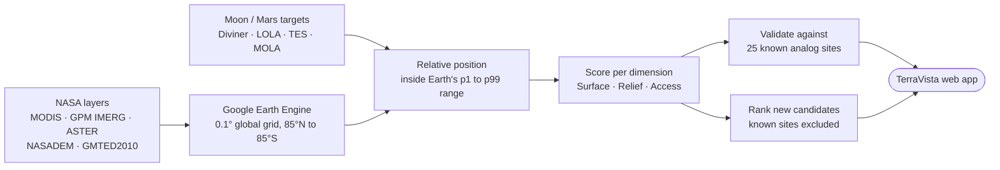

# Logos · NASA Space Apps Challenge 2026

<p align="center"></p>

Project of team **Logos** for the NASA Space Apps Challenge 2026 (Barcelona local event, 14-15 November 2026).

**Challenge:** [Identify Earth Locations that Analog the Permanent Moon Base Locations and Mars](https://www.spaceappschallenge.org/2026/challenges/permanent-moon-base-locations-and-mars/)

## TerraVista

A mobile-first web app that searches all land between 85°N and 85°S for places that resemble future Moon and Mars base sites, using NASA data processed in Google Earth Engine. For every place it explains **what is analogous, how much, and where the analogy breaks**.

- **Candidates**: global search over all land (excluding ~25 already-catalogued analog sites), validated against known analogs.
- **Analysis**: per-dimension similarity (Surface, Relief) for 5 reference sites against a selected target (Shackleton rim, Jezero crater, Arcadia Planitia), and where each Earth variable falls versus the target. Geology (thermal-infrared emissivity) and Ice are shown for Earth but have no Moon/Mars value yet, so they are not scored.
- **Data**: every layer with its raw type, resolution, temporal coverage, global range and Moon/Mars counterpart.
- **Maps**: NASA GIBS (Earth), Moon Trek (LRO WAC) and Mars Trek (MGS MOLA) basemaps.

## How it works



The Moon and Mars are more extreme than anywhere on Earth, so we don't compare raw values. Each variable becomes a **position inside Earth's own range** (p1 to p99), and similarity is `1 − |pos(site) − pos(target)|`. A target value beyond Earth's real minimum or maximum is flagged as the point **where the analogy breaks**. Full method: [docs/metodo.md](docs/metodo.md).

## Results

<p align="center"></p>

**Validation.** Most known analog sites (Atacama, McMurdo Dry Valleys, Devon Island, Svalbard…) score above the Earth-wide median for every target, so the scoring points the right way. Few of them reach the top 10 %, which tells us that well-known analogs were chosen for reasons our current layers don't capture yet (geology, ice, logistics).

**Discovery (v3, three phases).** 1 · *Geographic form* (surface + relief) keeps the 5 % of Earth that looks most like the target. 2 · *Climate conditioning* (MODIS temperature, GPM rain and NASA MERRA-2 atmosphere: surface pressure, wind, humidity, dust) keeps the best 10 % of those. 3 · *Accessibility* orders the survivors by travel time to the nearest city. The winners are the high, dry, thin-air plateaus of Central Asia (Tibet, Qinghai, Xinjiang, Kyrgyzstan, Afghanistan) and, for the Moon, the high Rockies of Colorado. For Mars, the dusty Qinghai and Taklamakan margins appear right next to Qaidam, a known Mars analog that we had excluded, which is a good sign. Honest caveat: few classic analogs survive both filters (0–1 of 25), because together they keep only ~0.5 % of Earth and many classic sites fail on atmosphere (Atacama air is very clean; Mars is dusty).

**Known limitations.** Moon/Mars target values are approximate literature figures, not computed from PDS products. Climate is shown for context but not scored, so the ranking favours accessible bare, arid terrain rather than the coldest places on Earth; the Moon's temperatures remain the clearest point where any Earth analogy breaks. Slope is measured at 5 km scale, where almost every mountain range is above Earth's 99th percentile; the app flags this as a tie at Earth's limit instead of a match. With only surface, slope and access, any bare, steep and reachable place scores well; geology (thermal-infrared emissivity) and ice are the next dimensions to add.

<sub>Chart generated from `src/data/ee-global.json` with `node scripts/readme/make-charts.mjs`.</sub>

## Run locally

```bash
npm install
npm run dev   # http://localhost:3000
```

## Repository layout

| Path | Content |
|---|---|
| `src/app/` | Next.js App Router pages and PWA manifest |
| `src/components/` | Tabs: Candidates, Analysis, Data and Maps |
| `src/lib/analysis.ts` | Relative-position similarity scoring |
| `src/data/` | Layer catalog, Moon/Mars target fingerprints and Earth Engine outputs (`ee-*.json`) |
| `scripts/ee/` | Google Earth Engine Code Editor scripts (inventory, samples, global search, asset export, scoring) |
| `docs/` | Project documentation (in Spanish): log, data, method, rules and challenge benchmark |

## Documentation (Spanish)

- [Bitácora](docs/bitacora.md): log of what was done and when
- [Valor añadido y modelo de impacto](docs/valor-anadido.md): business case, storytelling, dual-engine solution and ROI
- [Datos](docs/datos.md): layers, types, resolutions, ranges and samples
- [Método](docs/metodo.md): how similarity is computed
- [Normas](docs/normas.md): challenge rules that affect us
- [Benchmark de retos](docs/benchmark-retos.md): all 2026 challenges, competition and differentiation ideas

## Data and attribution

- **NASA**: MODIS (MOD11A2, MOD13C1, MCD43C3 for the global search; MOD13A2, MCD43A3, MOD10A1 for the reference sites), GPM IMERG, ASTER GED, NASADEM, GIBS, Moon Trek (LRO WAC, LOLA), Mars Trek (MGS MOLA, HRSC+MOLA), Mars 2020 CTX DTM of Jezero (USGS). Moon/Mars target values are approximate literature figures based on LRO Diviner/LOLA, MGS TES/MOLA and Perseverance MEDA (see `src/data/targets.ts`).
- **ESA**: Copernicus DEM GLO-30.
- **USGS**: GMTED2010 (global slope).
- **Globe textures** (`public/tex/`, processed only by resizing/recompressing): Earth, NASA GIBS Blue Marble; Moon, LROC WAC mosaic from the CGI Moon Kit, credit NASA's Scientific Visualization Studio (NASA/GSFC/Arizona State University); Mars, Viking MDIM 2.1 colour mosaic via NASA Mars Trek (NASA/USGS). Details in `docs/licencias-texturas.md`. No NASA logos are used.
- Earth layers accessed through Google Earth Engine (non-commercial project `terra-analog`).

## Use of AI

The idea and the approach (scoring all land against real Moon and Mars sites and showing where each analogy breaks) are the team's. We used an AI assistant, Claude Code (Anthropic), as a tool: it wrote and debugged code (web app, Earth Engine scripts), helped process and score the data, and drafted the documentation. The team reviewed the results. Generated images or video carry a visible watermark.
