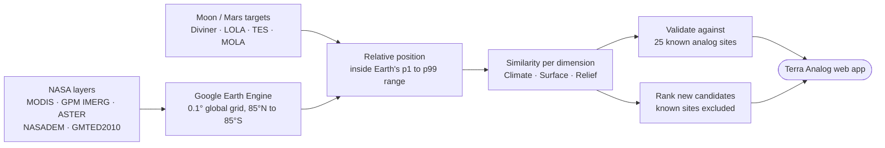

# Logos · NASA Space Apps Challenge 2026

<p align="center"></p>

Project of team **Logos** for the NASA Space Apps Challenge 2026 (Barcelona local event, 14-15 November 2026).

**Challenge:** [Identify Earth Locations that Analog the Permanent Moon Base Locations and Mars](https://www.spaceappschallenge.org/2026/challenges/permanent-moon-base-locations-and-mars/)

## Terra Analog

A mobile-first web app that searches all land between 85°N and 85°S for places that resemble future Moon and Mars base sites, using NASA data processed in Google Earth Engine. For every place it explains **what is analogous, how much, and where the analogy breaks**.

- **Candidates**: global search over all land (excluding ~25 already-catalogued analog sites), validated against known analogs.
- **Analysis**: per-dimension similarity (Climate, Surface, Relief) for 5 reference sites against a selected target (Shackleton rim, Jezero crater, Arcadia Planitia), and where each Earth variable falls versus the target. Geology (thermal-infrared emissivity) and Ice are shown for Earth but have no Moon/Mars value yet, so they are not scored.
- **Data**: every layer with its raw type, resolution, temporal coverage, global range and Moon/Mars counterpart.
- **Maps**: NASA GIBS (Earth), Moon Trek (LRO WAC) and Mars Trek (MGS MOLA) basemaps.

## How it works



The Moon and Mars are more extreme than anywhere on Earth, so we don't compare raw values. Each variable becomes a **position inside Earth's own range** (p1 to p99), and similarity is `1 − |pos(site) − pos(target)|`. A target value beyond Earth's real minimum or maximum is flagged as the point **where the analogy breaks**. Full method: [docs/metodo.md](docs/metodo.md).

## Results

<p align="center"></p>

**Validation.** Most known analog sites (Atacama, McMurdo Dry Valleys, Devon Island, Svalbard…) score above the Earth-wide median for every target, so the scoring points the right way. Few of them reach the top 10 %, which tells us that well-known analogs were chosen for reasons our current layers don't capture yet (geology, ice, logistics).

**Discovery.** The best *uncatalogued* candidates cluster in the **Canadian High Arctic (Nunavut)** and **High Asia (Xinjiang, Karakoram, Pamir)**, scoring 0.84 to 0.89.

**Known limitations.** Moon/Mars target values are approximate literature figures, not computed from PDS products. Most Moon/Mars temperatures are below Earth's minimum, so the climate score rewards the coldest places on Earth. Slope is measured at 5 km scale, where almost every mountain range is above Earth's 99th percentile; the app flags this as a tie at Earth's limit instead of a match. For Shackleton, Death Valley and Mauna Kea also reach the top 10 %: with only climate, surface and slope, any dry, bare and steep place looks lunar.

<sub>Chart generated from `src/data/ee-global.json` with `node scripts/readme/make-charts.mjs`.</sub>

## Run locally

```bash
npm install
npm run dev   # http://localhost:3000
```

## Repository layout

| Path | Content |
|---|---|
| `src/app/` | Next.js App Router pages and PWA manifest |
| `src/components/` | Tabs: Candidates, Analysis, Data and Maps |
| `src/lib/analysis.ts` | Relative-position similarity scoring |
| `src/data/` | Layer catalog, Moon/Mars target fingerprints and Earth Engine outputs (`ee-*.json`) |
| `scripts/ee/` | Google Earth Engine Code Editor scripts (inventory, samples, global search, asset export, scoring) |
| `docs/` | Project documentation (in Spanish): log, data, method, rules and challenge benchmark |

## Documentation (Spanish)

- [Bitácora](docs/bitacora.md): log of what was done and when
- [Valor añadido y modelo de impacto](docs/valor-anadido.md): business case, storytelling, dual-engine solution and ROI
- [Datos](docs/datos.md): layers, types, resolutions, ranges and samples
- [Método](docs/metodo.md): how similarity is computed
- [Normas](docs/normas.md): challenge rules that affect us
- [Benchmark de retos](docs/benchmark-retos.md): all 2026 challenges, competition and differentiation ideas

## Data and attribution

- **NASA**: MODIS (MOD11A2, MOD13C1, MCD43C3 for the global search; MOD13A2, MCD43A3, MOD10A1 for the reference sites), GPM IMERG, ASTER GED, NASADEM, GIBS, Moon Trek (LRO WAC, LOLA), Mars Trek (MGS MOLA, HRSC+MOLA), Mars 2020 CTX DTM of Jezero (USGS). Moon/Mars target values are approximate literature figures based on LRO Diviner/LOLA, MGS TES/MOLA and Perseverance MEDA (see `src/data/targets.ts`).
- **ESA**: Copernicus DEM GLO-30.
- **USGS**: GMTED2010 (global slope).
- Earth layers accessed through Google Earth Engine (non-commercial project `terra-analog`).
