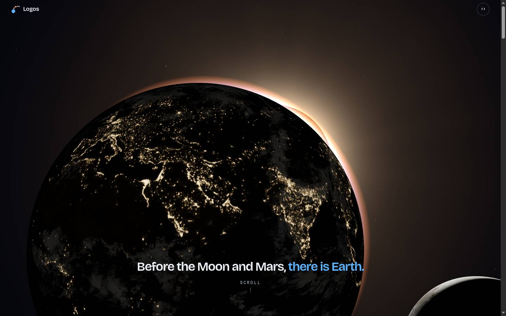
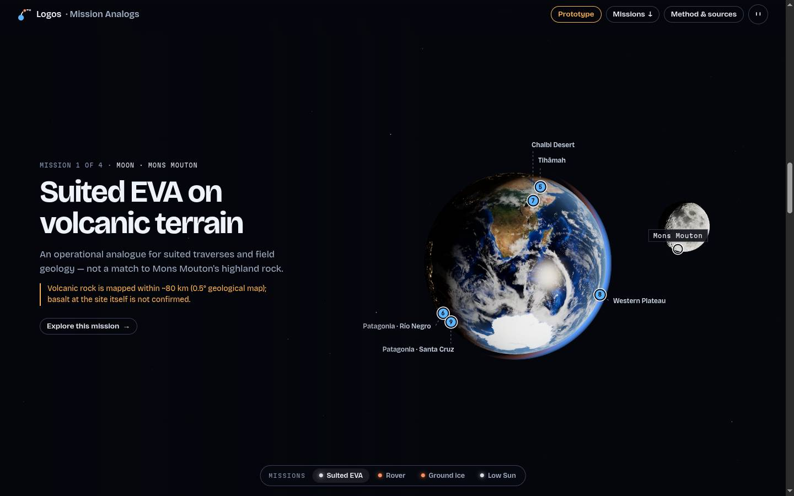
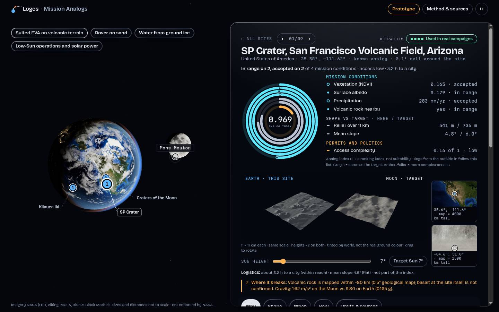
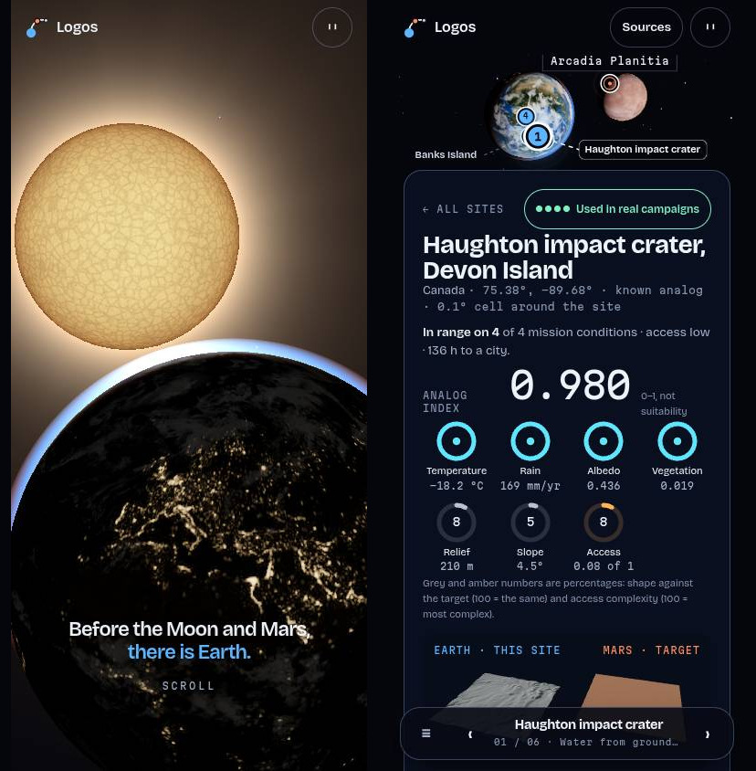

<div align="center">


# Terra Vista · Mission Analogs

**Where on Earth can we rehearse a specific Moon or Mars mission?**

NASA Space Apps Challenge 2026 · *Identify Earth Locations that Analog the Permanent Moon Base Locations and Mars* · team **Logos**

**[Open the live demo →](https://zenidx.github.io/logos-space-apps-2026/)** &nbsp;·&nbsp; [a site, straight away](https://zenidx.github.io/logos-space-apps-2026/?m=m1-eva-basalt&s=sp_crater_az) &nbsp;·&nbsp; [method](docs/logos/method.md) &nbsp;·&nbsp; [every source](docs/logos/sources.md)



</div>

> Prototype built during the hackathon (14–15 November 2026). Not endorsed by NASA or any organisation named here.

## The idea in one line

Most analog maps ask *"which place on Earth looks like the Moon?"*. We ask **"where on Earth can we rehearse *this* mission?"**, score all land on Earth against that one target, condition by condition, say **where the analogy breaks**, and add a neutral **access complexity** layer (how much coordination a field team would need). The idea is our team's own; see [Use of AI](#use-of-super-intelligence-si--ai).

## Four missions, from real field campaigns

| Mission | Target | Rehearsed for real at | Status |
|---|---|---|---|
| Suited EVA on volcanic terrain | Moon · Mons Mouton (south pole) | SP Crater (NASA JETT), Timanfaya (ESA PANGAEA), Craters of the Moon, Kīlauea Iki | validated |
| Rover on sand | Mars · Jezero crater | Dumont Dunes (JPL Scarecrow), Mars Desert Research Station, Yungay | validated |
| Water from ground ice | Mars · Arcadia Planitia | Haughton crater (NASA TRIDENT), McMurdo Dry Valleys | validated |
| Low-Sun operations and solar power | Moon · Mons Mouton | no campaign under a real low Sun (JETT3/JETT5 simulated it at night) | **computed, not validated** |

For each mission the app proposes **new regions to investigate** (19 in total), checked against satellite land cover, terrain and an independent literature review.

## What you can do in the app

<table>
<tr>
<td width="50%"></td>
<td width="50%"></td>
</tr>
<tr>
<td><b>Follow the story.</b> The first screen is only the scene; scrolling tells the idea one screen at a time, and each mission flies the camera to its target world. Hover a mission for a preview; click to open it.</td>
<td><b>Open a site.</b> Analog index, every condition against the range the mission needs, 3D terrain next to the target, the Sun's height, logistics, access complexity and <b>where it breaks</b>. Browse sites with ‹ › or the arrow keys.</td>
</tr>
</table>

- **Every number says where it comes from**: the dataset under each condition (Why tab) and on hover in the dial legend; the target's value with its own source.
- **Honest ordering**: lists are ordered by independent evidence (a campaign ran there, or what a literature check found nearby), not by the index, which cannot separate the top regions.
- **Filters** by travel time to a city, mean slope and access level (none of them is part of the index).
- **Real light**: the Sun, Earth, Moon and Mars are lit from the Sun's actual direction; orbit radii and periods are in real proportion.
- **Works on phones**: thumb bar to move between sites, mission cards with their figures, a scene that fills the screen.

<p align="center"></p>

## How it works (no server, no database)

```
public datasets ──► scripts/data/ (Python) ──► src/data/sites.json ──► Next.js static site + three.js
 MODIS · GPM ·       scores every 0.1° land       one small file         story, explorer, site panel
 SoilGrids · GLiM    cell per mission, screens                            (reads the file, nothing else)
 WGI · UCDP · DEMs   new regions, validates
```

1. **Score.** Each mission is a few surface conditions open data can measure (vegetation, albedo, rainfall, sand, volcanic rock, temperature, Sun height). Every 0.1° land cell gets an **analog index 0–1** per mission ([formula](docs/logos/method.md)).
2. **Validate.** The known campaign sites must come out near the top (e.g. 3 of 3 rover analogs in the top 2.1 % of land cells); a rainforest control must come out near the bottom.
3. **Screen.** Candidate regions are kept only if their 11 × 11 km window passes slope, water, ice and land-cover tests ([every candidate tried](docs/logos/region-screening.json)), and each is checked against the literature ([independent check](docs/logos/independent-check.md)).
4. **Show.** The web app only reads `sites.json`. Deep links: `?m=m1-eva-basalt | m2-rover-sand | m3-ground-ice | m4-low-sun`, plus `&s=<site id>`; `capture=1` for screen recording.

## Run it

```bash
npm install
npm run dev        # http://localhost:3000
npm test           # scene maths, label layout, dial data and rule tests
npm run test:data  # index formula: hand-computed cases + every published site
npm run build      # static export to out/
LOGOS_IN=/path/to/inputs npm run data:logos   # rebuild sites.json from the public datasets (Python; see scripts/data/README.md)
```

## Repository map

| Path | What |
|---|---|
| `src/app/(logos)/page.tsx` | Story and explorer |
| `src/components/logos/` | 3D scene (`SolarScene`), site panel, dial, terrain comparison, mission preview, method sheet |
| `src/lib/logos/` | Mission model, rules, scene maths, label layout (with tests) |
| `src/data/` | `sites.json` and derived terrain and climate files |
| `scripts/data/` | Data pipeline (inputs, versions and checksums in its README) |
| `docs/logos/` | [method](docs/logos/method.md), [sources](docs/logos/sources.md), [missions](docs/logos/missions.md), [independent check](docs/logos/independent-check.md), [design rationale](docs/logos/design-rationale.md); the original Spanish idea note is in [`docs/logos/es/origen-idea.md`](docs/logos/es/origen-idea.md) |

## Use of Super Intelligence (SI) / AI
The idea and the approach of this project are our team's own: finding Earth analog sites **per mission** and adding an **access-complexity index** — a team-defined coordination proxy shown next to each site, not part of the analog index and not a feasibility or safety assessment. No AI tool was used to come up with the idea or the problem framing.

We used AI (Claude agents by Anthropic, via Claude Code) as a tool, under the team's direction, for:
- **Code:** writing and debugging the web app and the data-processing scripts.
- **Data search:** finding and summarising field campaigns, public datasets and their licences, including the independent literature check of each new region. Source and licence checks, including unresolved items, are tracked in `docs/sources.md`.
- **Method drafting:** the scoring formula, thresholds and weights were drafted with AI assistance from the team's idea; they are documented as team choices in `docs/method.md`.
- **Design and writing:** a front-end design proposal, and drafting and editing documentation and texts in English.
- **Logo:** the Terra Vista logo (a lens holding Earth's horizon, with the Moon and Mars rising) was written by the AI as SVG vector code, from proposals the team chose between and asked to combine. No image-generation model was used.

AI-assisted outputs are reviewed by the team before submission. AI-assisted code and data files are listed in [`AI_USAGE.md`](AI_USAGE.md) and marked in their headers and metadata. We did not use image-, video- or audio-generation models. The only AI-assisted graphics are the logo files (`public/logo-symbol.svg`, `src/app/(logos)/icon.svg`, `public/apple-touch-icon.png`) and the logo and name placed on the social preview image (`public/og.png`). No AI-generated content contains NASA logos, insignia or other NASA marks.

## Data and credits
- Earth: NASA Blue Marble via NASA GIBS.
- Moon: LROC WAC mosaic, CGI Moon Kit, NASA's Scientific Visualization Studio (NASA/GSFC/Arizona State University).
- Mars: Viking MDIM 2.1 colour mosaic (NASA/USGS) via NASA Mars Trek.
- Earth at night: NASA Earth Observatory, Black Marble 2016 (Suomi NPP VIIRS); also used for the water mask. Clouds: NASA Visible Earth, Blue Marble cloud layer.
- Relief: LOLA (NASA SVS CGI Moon Kit) and MGS MOLA MEGDR (NASA PDS), as normal maps. Rebuild with `bash scripts/tex/make-textures.sh`.
- Software: three.js (MIT), Next.js (MIT, © Vercel, Inc.), React (MIT, © Meta Platforms, Inc.), Tailwind CSS (MIT).
- The 3D globe code is reused from our team's earlier prototype during this same hackathon.
- Missions: real analog field campaigns by NASA, ESA and the Mars Society (links in the app and in `docs/missions.md`).
- Earth data: NASA MODIS (MOD11A2, MOD13C1, MCD43C3), NASA GPM IMERG, ISRIC SoilGrids 2.0, GLiM; access layer: World Bank WGI, UCDP GED, US and UK travel advice, Natural Earth. Full list and licences in the app ("Method & sources") and `docs/method.md` and `docs/sources.md`.
- Terrain (11 × 11 km heightmaps in `public/heightmaps/`, each folder with its own NOTICE/LICENSE): Earth — Copernicus DEM GLO-30 (produced using Copernicus WorldDEM-30 © DLR e.V. 2010-2014 and © Airbus Defence and Space GmbH 2014-2018 provided under COPERNICUS by the European Union and ESA; all rights reserved. The organisations in charge of the Copernicus programme by law or by delegation do not incur any liability for any use of the Copernicus WorldDEM-30.); Moon — NASA LRO LOLA 30 m south-pole DEM (LDEM_75S_30M, LRO LOLA Team, NASA GSFC; Smith et al. 2010) via NASA Moon Trek; Mars — HRSC and MOLA Blended DEM 200 m v2 (USGS; MOLA NASA/GSFC CC0, HRSC ESA/DLR/FU Berlin CC BY-SA 3.0 IGO).
- Monthly temperature (MERRA-2), sunlight at the surface and clearness index (CERES SYN1deg): NASA POWER Climatology API v2.10.1 (retrieved 2026-11-14). The data was obtained from the NASA Langley Research Center (LaRC) POWER Project funded through the NASA Earth Science Division. Airports: OurAirports (public domain).
- The logistics filters, the terrain selector, the evidence levels and the "Hardware rehearsed" list were adapted from feature ideas of our team's parallel prototype for the same challenge; no code was reused, and they run on this project's own data.
- Design references (ideas only, no code copied): listed in `docs/design-rationale.md`. Locator maps are crops of the same NASA mosaics used on the globes.
- Travel time: Weiss et al. 2018 (Oxford MAP accessibility to cities 2015), CC BY 4.0 as distributed in the Google Earth Engine catalogue. Airports: OurAirports data (github.com/davidmegginson/ourairports-data, public domain).
- Ground screening of new regions: ESA WorldCover 2021 v200 (© ESA WorldCover project 2021 / contains modified Copernicus Sentinel data (2021) processed by ESA WorldCover consortium, CC BY 4.0) and Natural Earth glaciated areas. Results: `docs/region-screening.md` (every candidate tried: `docs/region-screening.json`); independent check of each new region against literature and agency sources: `docs/independent-check.md` and `docs/independent-check-v8.md`.
- Place names: Natural Earth (public domain) and © OpenStreetMap contributors (ODbL, openstreetmap.org/copyright). Target constants: NASA NSSDC Moon, Mars and Earth fact sheets (D. R. Williams, NASA GSFC). Volcanic rock: GLiM, Hartmann & Moosdorf 2012, doi:10.1594/PANGAEA.788537 (CC BY 3.0, creativecommons.org/licenses/by/3.0/; modified: basic-volcanic class aggregated in a 3×3 window).
- Front-end design proposal "Orbit" drafted with AI assistance; fonts (SIL Open Font License 1.1): Bricolage Grotesque © 2022 The Bricolage Grotesque Project Authors (github.com/ateliertriay/bricolage); Martian Mono © 2021 The Martian Mono Project Authors (github.com/evilmartians/mono).
- Screenshots in `docs/img/` are captures of this app (NASA imagery as credited above); they are not AI-generated.

## Licence
Code: MIT (see `LICENSE`). Third-party data and imagery keep their own licences (see `docs/sources.md`).

This project is not endorsed by NASA, ESA, JAXA, CSA or any organisation named here.
