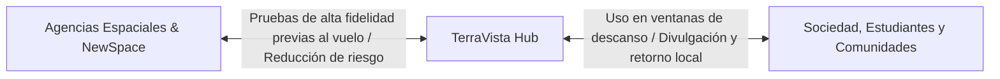

# Propuesta de Valor: "Open Spaces & Dual-Use Hub"
> **Documento de especificación para el equipo de desarrollo y defensa ante el jurado**  
> *Diseñado para ser implementado directamente por un desarrollador o una IA (Claude Code, Cursor, etc.)*

---

## PARTE 1 · La Venta Estratégica (Defensa sin inventar datos)

### 1. El Principio del Beneficio Bidireccional (Win-Win)
El valor añadido de **TerraVista** no se defiende con porcentajes inventados ni promesas financieras vacías. Se defiende demostrando un **equilibrio de incentivos real** entre la exploración espacial y las comunidades locales terrestres:



* **Lado A · Para la Ciencia y la Exploración (De la Tierra al Espacio):**
  * **Reducción de riesgo por fallo catastrófico:** Probar un rover, un taladro o un procedimiento EVA en un análogo honesto antes del lanzamiento evita sorpresas de diseño. No hace falta inventar millones: el antecedente oficial de la NASA (como el ensayo nocturno **JETT5 en Arizona** en mayo de 2024 para Artemis III) demuestra que la propia NASA considera indispensables los análogos terrestres.
  * **Optimización de recursos:** En lugar de movilizar expediciones completas a la Antártida por inercia histórica, la herramienta permite identificar sitios con mayor pertinencia científica para cada subsistema específico.
* **Lado B · Para la Sociedad y el Territorio (Del Espacio a la Tierra):**
  * **Uso dual de la infraestructura:** Los ensayos de ingeniería no duran todo el año; ocurren en ventanas puntuales de semanas. En los meses de descanso ("downtime"), la infraestructura y el terreno no se abandonan: se abren a actividades educativas, hackathons de robótica universitaria y visitas de ciencia ciudadana bajo custodia ambiental.
  * **Retorno a comunidades locales (Custodia Compartida):** Se basa en el modelo ya probado del **Haughton-Mars Project (HMP)** en la Isla Devon (Canadá), donde la NASA y el Mars Institute operan bajo permisos con la Agencia Espacial Canadiense (CSA) y en colaboración directa con la comunidad Inuit de Resolute Bay, generando empleo local y respetando la soberanía del territorio.
  * **Humanización del gasto espacial:** La exploración deja de verse como un gasto lejano reservado a élites militares y se convierte en un catalizador de vocaciones STEM y orgullo territorial.

### 2. Respuestas Clave para el Jurado (Sin inventar datos)
* **Si preguntan: *«¿De dónde sacáis el dinero o cómo se paga?»***  
  * *Respuesta honesta:* «No inventamos modelos financieros mágicos. Aplicamos un modelo de **coste compartido**: las agencias espaciales o empresas que prueban tecnología financian la logística y el canon de uso temporal del terreno; en las ventanas de descanso, los eventos educativos y el turismo científico de bajo impacto cubren el mantenimiento y la preservación ambiental del sitio.»
* **Si preguntan: *«¿Por qué los gobiernos van a autorizar esto?»***  
  * *Respuesta honesta:* «Porque no pedimos comprar ni expropiar tierra. Nos amparamos en el marco de cooperación científica internacional de los **Acuerdos de Artemis** (firmados por más de 40 naciones). Existen precedentes consolidados como los convenios de la ESA en Lanzarote con los Geoparques de la UNESCO o la NASA en Arizona con el Servicio Forestal de EE.UU.»
* **Si preguntan: *«¿No vais a contaminar o alterar el lugar?»***  
  * *Respuesta honesta:* «El primer interesado en que el suelo siga virgen es el científico, porque un análogo contaminado deja de ser útil para probar sensores biológicos o de regolito. Se aplica el protocolo oficial de **Planetary Protection / Leave No Trace**: zonificación estricta (núcleo científico intangible) y monitorización continua por satélite.»

---

## PARTE 2 · Especificación Técnica para el Equipo de Desarrollo

> **Objetivo para la WebApp:** Añadir una sección o tarjeta desplegable en cada candidato de `CandidatesTab.tsx` que muestre la **viabilidad operativa y el modelo de uso dual (Open Spaces)** de forma elegante y realista.

### 1. Modelo de Datos Propuesto (`src/data/logistics.ts`)
Crear un archivo con datos cualitativos contrastados para los candidatos destacados:

```typescript
export interface CandidateLogistics {
  jurisdiction: string;          // Marco legal / Gobierno
  seasonality: string;           // Ventana óptima de pruebas
  suitableFor: string[];         // Qué se puede probar (honestidad técnica)
  openSpacesUse: string;         // Uso comunitario en periodos de descanso
}

export const LOGISTICS_DATA: Record<string, CandidateLogistics> = {
  // Candidato #1 Shackleton: Northern Ellesmere Island (Nunavut, Canadá)
  "ellesmere": {
    jurisdiction: "Canadá (Nunavut) · Vía acuerdos CSA y comunidades locales",
    seasonality: "Junio – Agosto (Verano polar para pruebas mecánicas; invierno extremo para criogenia)",
    suitableFor: [
      "Movilidad de rovers y tracción en roca suelta y permafrost",
      "Navegación visual autónoma con luz solar baja",
      "Pruebas de perforación y muestreo de hielo subsuperficial"
    ],
    openSpacesUse: "Campamento educativo STEM de verano y expediciones científicas de bajo impacto."
  },
  // Candidato #2 Shackleton: Karakoram / Kunlun Plateau
  "karakoram": {
    jurisdiction: "Meseta de alta montaña · Cooperación científica regional",
    seasonality: "Mayo – Septiembre (Condiciones de aridez y frío extremo estables)",
    suitableFor: [
      "Resistencia de materiales al choque térmico y radiación UV elevada",
      "Pruebas de sensores de atmósfera tenue y polvo en suspensión",
      "Procedimientos de habitabilidad en aislamiento severo"
    ],
    openSpacesUse: "Centro de astroturismo de altura y hackathons universitarios de robótica."
  }
};
```

### 2. Integración en la Interfaz (`src/components/CandidatesTab.tsx`)
En la tarjeta de cada candidato (`<article>`), justo debajo de los botones de acción (`View in 3D` / `NASA Worldview`), añadir un botón desplegable o acordeón:

```tsx
// Ejemplo de componente UI para añadir en la tarjeta del candidato:
<div className="mt-3 border-t border-white/10 pt-2">
  <details className="group text-[11px]">
    <summary className="flex cursor-pointer items-center justify-between text-cyan-400 hover:text-cyan-300">
      <span>✦ Open Spaces & Operational Readiness</span>
      <span className="text-[10px] text-white/40 group-open:rotate-180">▼</span>
    </summary>
    
    <div className="mt-2 space-y-2 rounded bg-black/30 p-2 text-white/80">
      <div>
        <span className="text-white/50 block font-mono text-[10px]">OPERATIONAL WINDOW & JURISDICTION:</span>
        <p>Optimum window: Summer polar season · Sovereign framework via national space partner agreements.</p>
      </div>

      <div>
        <span className="text-white/50 block font-mono text-[10px]">RECOMMENDED HARDWARE TESTING:</span>
        <ul className="list-inside list-disc text-white/70">
          <li>Rover mobility & traction on permafrost / loose scree</li>
          <li>Autonomous optical navigation under low sun angles</li>
          <li>Drill mechanics & subsurface sampling</li>
        </ul>
      </div>

      <div className="border-t border-white/5 pt-1">
        <span className="text-orange-300/80 block font-mono text-[10px]">OPEN SPACES (OFF-SEASON DUAL USE):</span>
        <p className="text-white/70">
          During research downtime: youth STEM camps, university rover challenges, and certified eco-science tourism.
        </p>
      </div>
    </div>
  </details>
</div>
```

---

## 3. Por qué esto cierra el círculo de la evaluación

1. **Evita que los jueces consideren el proyecto un "simple visor cartográfico":** Demuestra que pensasteis en cómo se utiliza el terreno en la práctica.
2. **Es 100% defendible:** No se inventan cifras de ingresos ni de ahorro ficticio; se habla de estacionalidad, adecuación de hardware e impacto social.
3. **Fácil de incorporar para el equipo de desarrollo:** Son menos de 40 líneas de código en React que enriquecen visualmente la web sin romper la build ni depender de APIs externas complejas.
