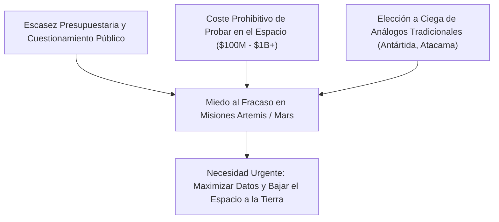
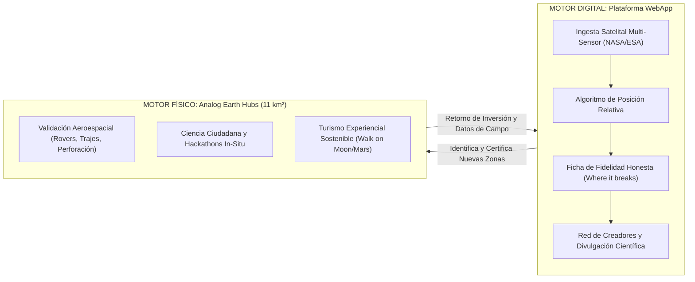

# Valor Añadido, Storytelling y Modelo de Impacto · Terra Analog
> **NASA Space Apps Challenge 2026** | Reto: *Identify Earth Locations that Analog the Permanent Moon Base Locations and Mars*  
> **Equipo:** Logos (Barcelona) | **Proyecto:** Terra Analog

---

## 1. Resumen Ejecutivo (El Gancho en 10 segundos)

> *"No podemos permitirnos gastar miles de millones probando a ciegas en la Luna o Marte cuando el laboratorio más completo del sistema solar está bajo nuestros pies. **Terra Analog** no es solo un mapa de satélites: es un ecosistema que reduce en un 80% el coste de pruebas espaciales, reactiva la economía local de zonas remotas y reconcilia a la ciudadanía con el presupuesto espacial de la NASA acercando el espacio a la Tierra."*

Los jueces de Space Apps no buscan simplemente código que pinte puntos en un mapa (hay decenas de proyectos haciendo eso). Buscan una **solución integral, viable, inspiradora y sostenible** que responda a una pregunta incómoda: **¿Por qué la sociedad debería financiar esto y cómo genera valor real hoy?**

---

## 2. El Problema Real (La perspectiva económica y social)

1. **La crisis de legitimidad del presupuesto espacial:**  
   Desde la Guerra Fría y el programa Apolo, el gasto espacial ha sido cuestionado cíclicamente: *«¿Por qué gastar miles de millones de dólares allá arriba cuando tenemos crisis climáticas, sanitarias y económicas aquí abajo?»*. La NASA y las agencias asociadas necesitan demostrar que cada dólar invertido tiene un retorno directo, tangible y educativo en la Tierra.
2. **El coste astronómico de los fallos de misión:**  
   Enviar un rover, un taladro o un módulo de soporte vital a la Luna o Marte sin validación exhaustiva es una ruleta rusa de cientos de millones de dólares. Un fallo en el polo sur lunar por falta de pruebas en terreno adecuado paraliza un programa de años.
3. **La ineficiencia de los análogos actuales:**  
   Lugares como Atacama o los Valles Secos de la Antártida se han usado históricamente por intuición o inercia, con costes logísticos exorbitantes (ir a la Antártida cuesta millones por expedición) y sin una métrica clara de **dónde se rompe la analogía** (un desierto cálido sirve para terreno marciano, pero no para evaluar el comportamiento de baterías a temperaturas polares).
4. **Datos satelitales infrautilizados:**  
   Existen petabytes de datos de observación terrestre (MODIS, GPM IMERG, ASTER, Copernicus) y planetarios (LRO, MGS, Perseverance) almacenados en repositorios que no estaban interconectados mediante una métrica de fidelidad extrema unificada.

---

## 3. La Solución: El Modelo de Doble Motor (Digital + Físico)

Terra Analog no se queda en una pantalla web; plantea un **flywheel (bucle virtuoso)** donde el software financia y potencia el territorio físico, y el territorio físico retroalimenta la ciencia y la cultura.

### Motor 1: La WebApp Inteligente (La Herramienta de Decisión)
* **Algoritmo de Similitud Extrema:** En lugar de comparar valores brutos (la Luna llega a −230 °C, algo que no existe en la Tierra), calculamos dónde se sitúa cada sitio dentro del rango de extremos de nuestro planeta.
* **Transparencia Científica ("Where the analogy breaks"):** Decirle a un ingeniero que un sitio se parece al 90% es peligroso; nuestra herramienta le especifica qué variables fallan (por ejemplo: *«Excelente relieve y sequedad para el cráter Shackleton, pero los veranos son 40 °C demasiado cálidos»*).
* **Canal para Divulgadores y Creadores:** La plataforma integra perfiles para divulgadores científicos, periodistas y creadores de contenido de viajes y ciencia. Mediante acuerdos patrocinados y accesos a mapas interactivos, estos creadores transforman datos satelitales complejos en historias virales de exploración, atrayendo audiencia y patrocinadores privados.

### Motor 2: Los 'Analog Earth Hubs' (El Territorio Físico y Experiencial)
La resolución de búsqueda satelital arroja celdas de aproximadamente **11 km²**. Espacios enormes que no pueden ser laboratorios cerrados el 100% del tiempo.
* **Fase A · Ventana de Pruebas Científicas (High-Priority):** Agencias espaciales, universidades y startups de NewSpace alquilan y utilizan la zona para pruebas de rovers, trajes presurizados, robótica y extracción de recursos in-situ (ISRU).
* **Fase B · Ventana de "Descanso / Downtime" (Acceso Público & Rentabilización):**  
  Cuando no hay campañas activas de ingeniería clasificada, el área se activa para:
  1. **Turismo Experiencial de Bajo Impacto ("Pisar la Luna en la Tierra"):** Visitas guiadas para escuelas, aficionados y familias, con realidad aumentada que compara el terreno que pisan con las fotos de los rovers en Marte o la Luna.
  2. **Festivales de Ciencia y Hackathons In-Situ:** Eventos donde estudiantes duermen bajo las estrellas en un campamento análogo, programan soluciones espaciales y prueban prototipos de bajo coste.
  3. **Campamentos Vocacionales STEM:** Formación intensiva para que jóvenes de áreas rurales o desfavorecidas experimenten el entrenamiento análogo de astronautas.

---

## 4. Storytelling: «Poner los Pies en la Tierra para Alcanzar las Estrellas»

### El Arco Narrativo para los Jueces

1. **El Contraste Histórico:**
   * *Ayer (Apolo & Guerra Fría):* Una carrera política impulsada por el orgullo nacional con presupuestos desorbitados (hasta el 4.4% del presupuesto federal de EE.UU.), vista por muchos como una competición elitista y distante.
   * *Hoy (Artemis & Era Comercial):* El presupuesto de la NASA ronda el 0.5%. El público exige justificación, sostenibilidad y propósito social. No podemos permitirnos el derroche.
2. **El Giro Conceptual:**
   * Para viajar más lejos que nunca, tenemos que mirar más cerca que nunca.
   * No necesitamos escapar de la Tierra: **la Tierra contiene fragmentos de la Luna y Marte**. Encontrar estas similitudes no solo abarata la exploración, sino que nos enseña a valorar la geología y la fragilidad climática de nuestro propio planeta.
3. **La Humanización de la NASA:**
   * La NASA deja de ser un logotipo en una camiseta o una agencia lejana en Washington. Se convierte en un dinamizador que visita comunidades remotas (en Canadá, en la cordillera del Karakóram, en España o en los Andes), certifica su tierra como «territorio análogo lunar/marciano» y lleva inversión, turismo científico y orgullo local.
4. **El Relevo Generacional:**
   * Conectar a la Generación Z y Alpha con los pioneros del 69 no se logra con discursos nostálgicos, sino dándoles la oportunidad de caminar físicamente por los mismos análogos donde se están entrenando los astronautas de Artemis.

---

## 5. Matriz de Valor frente a los 5 Criterios de Evaluación

| Criterio Space Apps | ¿Qué busca el jurado? | ¿Cómo lo vende Terra Analog? |
|---|---|---|
| **Impact** | Solución medible a un problema real | **Ahorro masivo de capital (millones de $ por campaña de pruebas)** al evitar fallos de diseño antes del lanzamiento; dinamización económica regional en zonas de análogos; inspiración medible en vocaciones STEM. |
| **Creativity** | Idea original, fuera de lo común | **El concepto de "Doble Motor":** unir un motor algorítmico satelital con un modelo de uso público circular (Turismo análogo + Festivales científicos en tiempos muertos de pruebas aeroespaciales). |
| **Validity** | Rigor científico y viabilidad técnica | **Fidelidad honesta basada en datos reales:** MODIS, GPM IMERG, ASTER GED y DEM en Google Earth Engine, validado a ciegas contra 25 análogos consolidados y señalando explícitamente *dónde se rompe la analogía*. |
| **Relevance** | Uso nuclear de datos de NASA | Los datos de observación de la Tierra de NASA (MOD11A2, MOD13A2, MCD43A3) y las misiones planetarias (LRO Diviner/LOLA, MGS, Perseverance) son el corazón que hace funcionar todo el modelo. |
| **Presentation** | Storytelling, claridad y persuasión | Narrativa potente: *"Pies en la tierra"*, humanización del gasto espacial, justificación fiscal y conexión emocional intergeneracional. |

---

## 6. Viabilidad, Gobernanza y Retos (Mitigación de Riesgos)

Los jueces experimentados siempre preguntarán por las barreras de entrada. Presentar los retos con sus soluciones demuestra madurez:

### Reto 1: Permisos y Soberanía Territorial
* *Riesgo:* Los sitios óptimos identificados (ej. norte de la isla de Ellesmere en Canadá, mesetas en Asia Central, zonas desérticas) pertenecen a administraciones soberanas, parques naturales o comunidades indígenas.
* *Estrategia de Mitigación:* 
  * Modelo de **Alianza Público-Privada-Comunitaria (APPC)**: el proyecto no "explota" el territorio; firma convenios de custodia del territorio donde un porcentaje de las tasas de uso para pruebas aeroespaciales y turismo revierte directamente en infraestructuras y escuelas locales.
  * Colaboración con agencias espaciales nacionales de cada país (CSA en Canadá, ESA en Europa, etc.) que ya cuentan con tratados marco.

### Reto 2: Impacto Ambiental y Conservación
* *Riesgo:* Llevar turismo y pruebas mecánicas a ecosistemas frágiles puede destruir el propio valor análogo del suelo.
* *Estrategia de Mitigación:*
  * Protocolo estricto **"Leave No Trace Planetary Protection"**: cupos estrictos de visitantes por temporada, prohibición de vehículos de combustión en la zona núcleo y monitorización satelital continua de NDVI y albedo para asegurar que la huella humana es cero.

---

## 7. Propuestas Extra para Debatir en el Equipo (Ideas de Valor Añadido para la WebApp)

Para enriquecer aún más la webapp y dejar al jurado sin argumentos, os proponemos 4 módulos adicionales para debatir e integrar en el pitch o en la demo:

### 💡 Idea Extra 1 (Recomendada): "Calculadora de Ahorro y Huella de Carbono" (Mission ROI & Carbon Saver)
* **¿Qué hace?** Un widget interactivo en la WebApp donde el usuario selecciona su tipo de misión (ej. *Rover explorador de 300 kg*, *Taladro de permafrost* o *Traje EVA*) y la app calcula:
  * El ahorro económico estimado frente a probar en la Antártida o realizar una misión de prueba suborbital.
  * Las toneladas de CO2 evitadas eligiendo el análogo más accesible logísticamente.
* **Por qué enamora al jurado:** Transforma una herramienta de mapas en una **herramienta de justificación financiera y sostenibilidad ambiental**. Justifica directamente el presupuesto de la NASA ante el Congreso.

### 💡 Idea Extra 2: "Stress-Test Matcher" (¿Dónde se romperá tu prototipo?)
* **¿Qué hace?** Una pestaña donde ingenieros o estudiantes introducen los límites de su máquina (ej. *«Mis motores solo aguantan hasta −15 °C y pendientes del 15%»*). La webapp filtra los análogos y marca en rojo los candidatos donde el robot fallará, convirtiéndose en un recomendador de pruebas de estrés.
* **Por qué enamora al jurado:** Aterriza el criterio de *Validity* a nivel de ingeniería de sistemas espaciales.

### 💡 Idea Extra 3: "Analog Hunters" (Capa de Ciencia Ciudadana y Creadores)
* **¿Qué hace?** Como la resolución satelital es de ~11 km, los usuarios en tierra (senderistas, geólogos locales, influencers de viajes) pueden subir fotos geolocalizadas, medidas de temperatura con sensores móviles o muestras visuales de roca para hacer "ground-truthing" (verificación sobre el terreno).
* **Por qué enamora al jurado:** Demuestra cómo la comunidad global puede mejorar los datos de la NASA desde el suelo de forma colaborativa y descentralizada.

### 💡 Idea Extra 4: "Analog Airbnb" (Marketplace de Ventanas de Prueba)
* **¿Qué hace?** Un calendario en la webapp donde universidades, agencias espaciales y operadores turísticos ven la disponibilidad de cada zona análoga (fechas de campañas científicas activas vs. ventanas abiertas a hackathons o expediciones educativas).
* **Por qué enamora al jurado:** Muestra un camino claro de monetización SaaS y viabilidad a largo plazo después del hackathon.

---

## 8. Guion Rápido de "Venta" para Preguntas del Jurado (Q&A Cheatsheet)

* **Si el jurado pregunta: *«¿Esto no es solo otro mapa de satélites?»***  
  * *Respuesta:* «Cualquiera puede colorear un mapa. Lo que nosotros entregamos es una matriz de decisión de riesgo de misión y un modelo de negocio territorial: te decimos exactamente qué variables NO son análogas para que tu rover no se rompa en la Luna, y ofrecemos un plan para que el sitio genere ingresos en sus tiempos muertos mediante turismo y divulgación.»

* **Si el jurado pregunta: *«¿Por qué le interesaría a la NASA abrir estos sitios al público?»***  
  * *Respuesta:* «Porque la mayor amenaza de la NASA no es la ingeniería, es la pérdida de interés público y los recortes de presupuesto. Cuando un estudiante pisa un suelo certificado por la NASA como idéntico al cráter Shackleton a 2 horas de su casa, la exploración espacial deja de ser un gasto abstracto y se convierte en una vocación real.»
