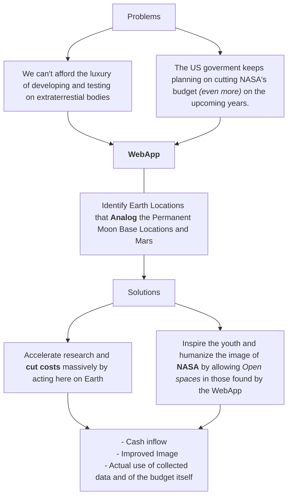

# TerraVista

*How bringing you down to Earth will keep you dreaming.*

## Flowchart

## Scene 1 - Introduction
> Rocket taking off, astronauts jumping on the moon, babies crying, crowd cheering...

Humanity has always dreamt about the stars. About what could be up there.

Just around 50 years ago, pressured by the cold war, NASA succesfully put humans on the moon: *One small step for a man, one giant leap for mankind*.

Nowadays, NASA faces a different challenge: Prove that it is still needed for the good of mankind.

## Scene 2 - Budget reduction
> Dramatic chart.

The US won the cold war, but once it was all over, keeping such a high investment on NASA didn't seem reasonable anymore. Consequently, its budget has weakened over time: *show the real numbers in a dramatic chart*.

## Scene 3 - Underused satelite data
> Visual explanation of the data (maybe using the WebApp itself).

Furthermore, NASA collects terabytes of data, underused data to which we aim to find a purpose.

## Scene 4 - Building TerraVista (WebApp)
> Various screens showing how the WebApp works.

**TerraVista** is the WebApp that allows to find *Earth Locations that **Analog** the Permanent Moon Base Locations and Mars*.

## Scene 5 - Open Spaces
> Dramatic scenes of brutal environments in Earth, Mars and the Moon.

Once the sites are found, project **Open Spaces** can be launched. Where:

- Sites can be use for science divulgation.
- In-site science events.
- Humanize NASA - bringing it down to Eart.
- Host influencers.
- Showcase the very peak of Human Ingenuity.
- Working with Universities.
- Leasing the site to other private reasearch firms.

## Scene 6 - Conclusion
> Cite on screen

*"NASA’s biggest problem is not engineering; it is the loss of public interest. When a student sets foot on ground certified by NASA, space exploration ceases to be an abstract expense and becomes a real vocation."*
